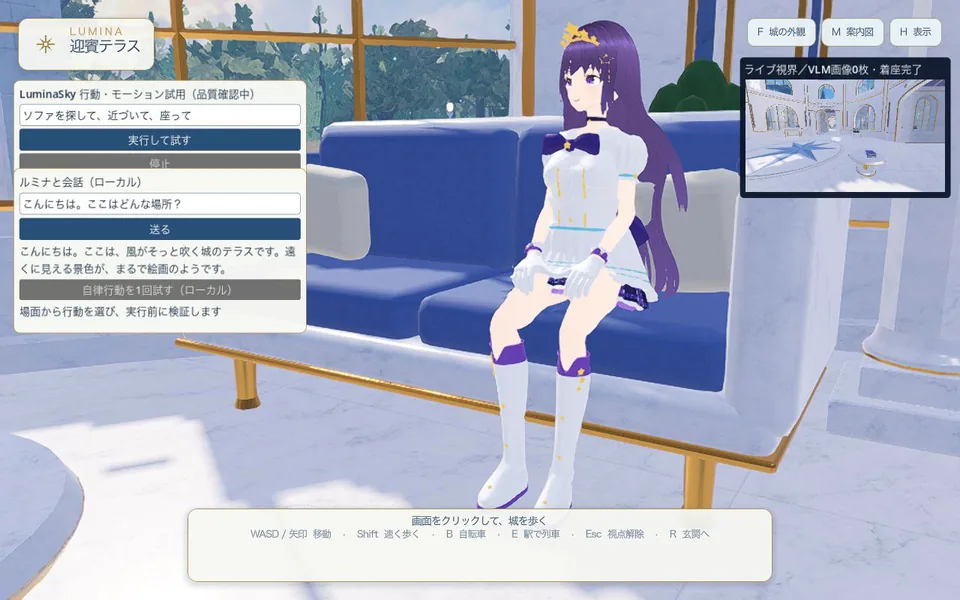

# Lumina（ルミナ）公式サイト

**Lumina は、人と会話し、3D空間の様子を見て行動するキャラクターを目指す、個人開発のプロジェクトです。** このリポジトリでは、プロジェクトを紹介する公式サイトを公開しています。

[公式サイトを見る](https://hoshikuzukobo42-maker.github.io/lumina-hp/) ｜ [試作動画・開発状況](https://hoshikuzukobo42-maker.github.io/lumina-hp/development.html#demo-video) ｜ [開発用ソース](https://github.com/hoshikuzukobo42-maker/luminaproject) ｜ [お問い合わせ](https://hoshikuzukobo42-maker.github.io/lumina-hp/#contact)

## どんなプロジェクトか

会話、周囲の観察、3D空間での移動や着席をつなぎ、人と同じ仮想空間で過ごせるAIキャラクターを作っています。公開中の試作動画では、会話画面のある空間で、ルミナがソファへ移動して座る様子を紹介しています。

サイトでは、キャラクターの紹介に加え、[開発状況・試作動画](https://hoshikuzukobo42-maker.github.io/lumina-hp/development.html)と[利用・二次創作ガイドライン](https://hoshikuzukobo42-maker.github.io/lumina-hp/guidelines.html)を掲載しています。お仕事や企業利用については、[お問い合わせ案内](https://hoshikuzukobo42-maker.github.io/lumina-hp/#contact)をご覧ください。

## 開発と公開の状況

- Luminaは制作者のMacで開発している試作で、一般向けのアプリや体験版は配布していません。
- 動画は2026年11月1日収録、音声なしです。録画用に１コマずつ記録したため、映像の再生時間は実際の所要時間と一致しません。
- [開発用ソースのリポジトリ](https://github.com/hoshikuzukobo42-maker/luminaproject)は、2026年9月10日時点の選別された公開版です。動画の試作環境そのものではなく、アバターや部屋、AIモデルなども含まれていません。

このリポジトリに含まれるのは、公式サイトのHTML・CSS・JavaScriptや公開用の画像・動画です。AIキャラクター本体の配布物ではありません。サイトはGitHub Pagesで公開しています。
